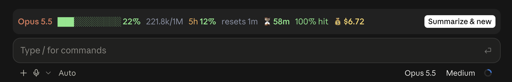

# usage-band

A live status band above the Claude Code prompt. It shows what you're spending and how close you are to your limits while you work, without running `/cost` or `/context`.



Works in the terminal and in the Claude desktop app's Code tab.

## What each part means

| Segment | Example | Meaning |
|---|---|---|
| Model | `Sonnet 5.5` | The model the session is on. |
| Context | `███░░░░░░░ 3%   32.3k/1M` | How full the context window is. Green, then amber from 50%, red from 80%. |
| 5-hour limit | `5h 9%   resets 11m` | Your plan's 5-hour usage window and when it resets. Adds a red `▲ full in 1h 20m` when your current pace would hit the limit before the reset. |
| Prompt cache | `⏳ 59m   70% hit` | Time left before the prompt cache expires, and how much of the last request came from cache. See below. |
| Cost | `💰 $0.13` | What the session would cost at API prices. |
| Button | `Summarize & new` | Has Haiku write a hand-off summary, runs `/clear`, and puts the summary in the prompt box of the fresh session. |

### The prompt cache, briefly

Every message re-sends the whole conversation. Anthropic caches it, so while the cache is warm each message is faster and much cheaper; once it expires, the next message pays full price to rebuild it. Every request resets the timer.

The band reads this from the API's own usage data in the session transcript, not from a guess:

- **Time left** counts from the last API request, using the TTL that request actually wrote (`1h` or `5m`).
- **Hit %** is the share of the last request served from cache. Red means it paid close to full price.
- `cold, new model` appears after switching models: each model has its own cache.
- An amber `5m TTL` appears if the API fell back to the 5-minute cache.

## Install

```bash
claude plugin marketplace add Rishit30G/usage-band
claude plugin install usage-band@rishit-plugins
```

Then start a new session (or restart the app).

## Update

```bash
claude plugin marketplace update rishit-plugins
claude plugin update usage-band@rishit-plugins
```

## Uninstall

```bash
claude plugin uninstall usage-band@rishit-plugins
claude plugin marketplace remove rishit-plugins
```

## Requirements and limits

- **A recent Claude Code.** The band uses the plugin hooks API (`ui.render`, `$.session.usage`). Older versions won't load it.
- **macOS or Linux.** The cache segment reads the transcript with `sh`, `tail` and `grep`. On Windows that segment stays hidden; the rest works.
- **Plan limits need a subscription.** The 5-hour segment appears only when the API reports rate-limit data (Pro/Max plans). On API-key billing it's hidden.
- **Summarize & new** uses a small Haiku call on your own quota.

## License

MIT
